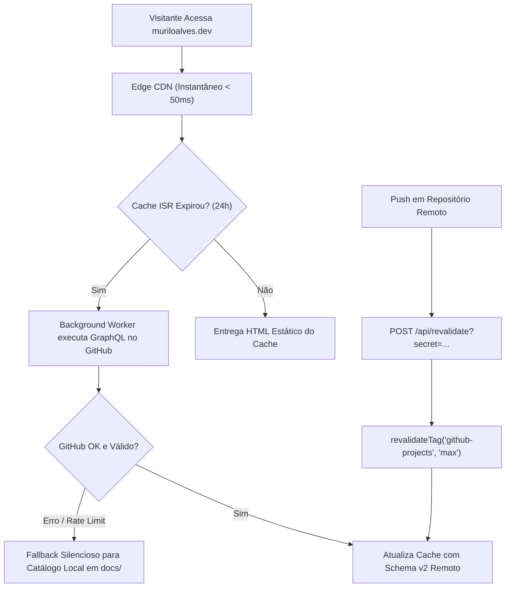

# muriloalves.dev // Portfólio de Engenharia de Sistemas & Software

[](https://github.com/Nubi-Prey/muriloalves.dev/actions/workflows/ci.yml)
[](https://nextjs.org/)
[](https://react.dev/)
[](https://www.typescriptlang.org/)
[](https://tailwindcss.com/)
[](https://pnpm.io/)
[](https://vitest.dev/)
[](https://opensource.org/licenses/MIT)

Portfólio de engenharia de software e sistemas de **Murilo Alves** ([muriloalves.dev](https://muriloalves.dev)), construído com estética **Cyber-Industrial Terminal Documental**, arquitetura orientada a dados auditados do GitHub via **GraphQL com Cache Components (Next.js 16)**, superfície completa de **SEO, GEO & AI SEO** (`schema.org` JSON-LD, `/llms.txt`, `/llms-full.txt`, OpenGraph dinâmico), internacionalização nativa instantânea (**pt_BR** / **en_US**), suporte a tema duplo rígido (**Dark / Light**) e suíte completa de testes automatizados.

---

## 🏛️ Filosofia de Design & Arquitetura

O site foi concebido sob a estética de interfaces industriais e documentação técnica de alta densidade:
- **Cantos retos (`0px`) e sombras mecânicas cinéticas:** Bordas rígidas de 2px, sombras de bloco de `4px 4px 0px 0px` e elevação ampliada para `6px 6px 0px 0px #b83a20` (Terracotta) no hover e touch active.
- **Dual Theme com `next-themes`:**
  - **Dark Mode:** *Cyber-Industrial Pitch Stone* (`#121314` base, `#191b1e` cards, acentos Terracotta `#b83a20`, Sage Tático `#4e6851` e Areia `#dcc9a9`).
  - **Light Mode:** *Technical Blueprint Stone* (`#f5f5f4` base, `#ffffff` cards com contornos pretos industriais `#1c1b1d`).
- **Internacionalização Instantânea (i18n):** Alternador no cabeçalho `[PT | EN]` que comuta todo o DOM em memória sem recarregar a página, com persistência em `localStorage` e sincronização via `useSyncExternalStore`.
- **Responsividade Rígida:**
  - **Mobile (< 768px):** Grade rigorosa de **1 coluna única (`grid-cols-1`)**, botões de ação ocupando largura total (`w-full`) com touch target mínimo de 44px e menu terminal retrátil (`md:hidden`).
  - **Tablet (768px - 1023px):** Grade balanceada de **2 colunas (`md:grid-cols-2`)**.
  - **Desktop (>= 1024px):** Grade ampla de **3 colunas (`lg:grid-cols-3`)**.

---

## ⚡ Integração GitHub GraphQL + ISR (Incremental Static Regeneration)

Os projetos em destaque não utilizam dados estáticos embutidos em código (*hardcoded*). O servidor consulta a API GraphQL oficial do GitHub em tempo de compilação e revalidação:



1. **Next.js 16 Cache Components:** Utiliza as diretivas nativas `"use cache"`, `cacheLife("days")` e `cacheTag("github-projects")`.
2. **Schema v2 Bilíngue:** Cada repositório remoto mantém seu próprio arquivo `.github/portfolio.json` com especificações técnicas nos dois idiomas. Uma única requisição alimenta ambos os idiomas.
3. **Fallback Offline / Zero-Downtime:** Se a API do GitHub estiver inacessível, com rate limit esgotado ou sem internet em ambiente de desenvolvimento local, o sistema consome automaticamente o catálogo pré-validado em [`docs/portfolio_json_configs/`](./docs/portfolio_json_configs/). A aplicação nunca quebra.
4. **Revalidação Sob Demanda (*On-Demand ISR*):** Rota protegida em `/api/revalidate` (com validação de segredo em tempo constante via `crypto.timingSafeEqual`) que purga o cache imediatamente via `POST` ou `GET`:
   ```bash
   curl -X POST "https://muriloalves.dev/api/revalidate?secret=SEU_REVALIDATE_SECRET"
   ```

---

## 🔍 SEO, GEO (Generative Engine Optimization) & AI SEO

O portfólio implementa descoberta estruturada para buscadores tradicionais, motores de resposta generativa (Google AI Overviews, Perplexity, ChatGPT Search, Claude) e agentes de IA:

- **Grafo JSON-LD (`schema.org` `@graph` em [`src/lib/structured-data.ts`](./src/lib/structured-data.ts)):** Desambiguação formal de `WebSite`, `ProfilePage`, `Person` (`Murilo Alves` / `Nubi-Prey`, `sameAs` GitHub e LinkedIn, `knowsAbout`) e `ItemList` de `SoftwareSourceCode` para os 6 projetos auditados, injetado no SSR/ISR inicial com sanitização XSS (`\u003c`).
- **Endpoints `/llms.txt` e `/llms-full.txt` ([`src/lib/llms-content.ts`](./src/lib/llms-content.ts)):**
  - [`https://muriloalves.dev/llms.txt`](https://muriloalves.dev/llms.txt): Índice estruturado de leitura rápida para LLMs e agentes.
  - [`https://muriloalves.dev/llms-full.txt`](https://muriloalves.dev/llms-full.txt): Dossiê técnico completo e **bilíngue (`en-US` + `pt-BR`)**, expondo 100% dos campos `tagline` e os 3 `highlights` arquiteturais por projeto do Schema v2.
- **OpenGraph & Twitter Image Dinâmica ([`src/app/opengraph-image.tsx`](./src/app/opengraph-image.tsx)):** Card `1200x630` PNG gerado estaticamente no build via `next/og` (`ImageResponse`) com a estética *Cyber-Industrial Brutalist*.
- **Diretivas para AI Crawlers ([`src/app/robots.ts`](./src/app/robots.ts) & [`src/app/sitemap.ts`](./src/app/sitemap.ts)):** Permissão explícita para `GPTBot`, `OAI-SearchBot`, `ChatGPT-User`, `ClaudeBot`, `PerplexityBot` e `Google-Extended`, com indexação de `/`, `/llms.txt` e `/llms-full.txt` no `/sitemap.xml`.

---

## 📦 Repositórios em Destaque (Auditados)

| Projeto | Casing Real | Categoria | Badge | Especificação Técnica Chave |
| :--- | :--- | :--- | :--- | :--- |
| [**MineOS**](https://github.com/Nubi-Prey/MineOS) | `Nubi-Prey/MineOS` | Sistemas & Kernel | `BAREMETAL` | JeOS Buildroot, DRM/KMS, compositor Wayland em Rust (Smithay) acoplado a JVM Java 25 via Fabric |
| [**Engraver**](https://github.com/Nubi-Prey/Engraver) | `Nubi-Prey/Engraver` | Computação Gráfica | `IMAGE PROCESSING` | Dithering de difusão de erro em C puro (`ctypes`), PySide6 (Qt6), OpenCV e empacotamento Nuitka |
| [**Lupa**](https://github.com/Nubi-Prey/lupa) | `Nubi-Prey/lupa` | Aplicação Desktop | `LOCAL-FIRST ERP` | Catálogo desktop em Electron 39, React 19, Tailwind v4, Zustand 5, Fuse.js 7 e MongoDB Atlas |
| [**EstoqueLentes**](https://github.com/Nubi-Prey/estoquelentes) | `Nubi-Prey/estoquelentes` | Aplicação Desktop | `DESKTOP EMBEDDED` | Gestão óptica com SQLite embutido via `better-sqlite3`, Drizzle ORM e Electron IPC seguro |
| [**Astolfo-bot**](https://github.com/Nubi-Prey/Astolfo-bot) | `Nubi-Prey/Astolfo-bot` | Backend & DevOps | `ASYNC CONCURRENCY` | Bot orientado a eventos em Java 17 com JDA 5, PostgreSQL 16 provisionado via Docker Compose |
| [**BLACK PC port (Port Linux)**](https://github.com/Nubi-Prey/black-pc) | `Nubi-Prey/black-pc` | Sistemas & Engenharia Reversa | `LINUX PORT CONTRIBUTION` | Contribuição open source ao black-pc (Spark198rus): port nativo para Linux com shims POSIX para o Xbox kernel, DXVK sobre Vulkan e SDL2 |

---

## 🛠️ Tecnologias Utilizadas

- **Framework:** [Next.js 16.4.3](https://nextjs.org/) (App Router, Turbopack, Partial Prefetching, Cache Components)
- **Biblioteca de UI:** [React 19.3.0](https://react.dev/)
- **Estilização:** [Tailwind CSS v4](https://tailwindcss.com/) com `@tailwindcss/turbopack`
- **Gerenciador de Pacotes:** [pnpm 12.15](https://pnpm.io/)
- **Linguagem:** [TypeScript 5](https://www.typescriptlang.org/) (modo estrito)
- **Tema:** [next-themes](https://github.com/pacocoursey/next-themes)
- **Testes Unitários & Integração:** [Vitest 5](https://vitest.dev/) + [@testing-library/react](https://testing-library.com/) + [jsdom](https://github.com/jsdom/jsdom)
- **Qualidade de Código:** [ESLint 9](https://eslint.org/) (com `eslint-config-next`)

---

## 🚀 Como Executar Localmente

### Pré-requisitos
- **Node.js** >= 20.x
- **pnpm** >= 9.x / 12.x

### Instalação
```bash
git clone https://github.com/Nubi-Prey/muriloalves.dev.git
cd muriloalves.dev
pnpm install
```

### Configuração de Ambiente (Opcional para Dev)
Crie um arquivo `.env.local` baseado no modelo:
```bash
cp .env.example .env.local
```
Preencha seu token do GitHub caso deseje consultar a API GraphQL ao vivo durante o desenvolvimento (se omitido, o fallback local é acionado automaticamente sem erros):
```env
GITHUB_TOKEN=seu_github_pat
REVALIDATE_SECRET=seu_segredo_para_revalidacao
GITHUB_USERNAME=Nubi-Prey
```

### Servidor de Desenvolvimento
```bash
pnpm dev
```
Acesse `http://localhost:3000`.

---

## 🧪 Qualidade de Código & Testes

O projeto conta com **49 testes automatizados** distribuídos em 7 suítes cobrindo integridade i18n, alternância de tema, responsividade mobile, semântica, SEO/GEO/AI SEO (`JSON-LD`, `/llms.txt`, `/llms-full.txt`, `opengraph-image`, `robots.txt`, `sitemap.xml`), renderização de componentes e resiliência de cache GraphQL:

```bash
# Executar todos os testes com Vitest
pnpm test

# Executar testes em modo watch
pnpm test:watch

# Checagem estrita de tipos no TypeScript
pnpm run typecheck

# Análise estática com ESLint
pnpm run lint

# Compilação otimizada para produção (Turbopack)
pnpm run build
```

---

## 🔒 Variáveis de Ambiente

| Variável | Obrigatória | Padrão | Descrição |
| :--- | :---: | :---: | :--- |
| `GITHUB_TOKEN` | Não | *vazio* | Token PAT do GitHub com permissão de leitura de repositórios públicos. Se ausente, usa o catálogo local |
| `REVALIDATE_SECRET` | Sim (p/ revalidação) | *vazio* | Chave secreta necessária para acionar a rota `/api/revalidate` em produção |
| `REVALIDATE_SECONDS` | Não | `86400` | Tempo de vida em segundos do cache ISR (padrão: 24 horas) |
| `GITHUB_USERNAME` | Não | `Nubi-Prey` | Usuário do GitHub cujos repositórios fixados serão consultados |

---

## 📄 Licença

Distribuído sob a licença [MIT](./LICENSE). Veja `LICENSE` para mais informações.

---

## 📬 Contato

- **Murilo Alves**
- **Website:** [muriloalves.dev](https://muriloalves.dev)
- **E-mail:** [muriloalvesnp@gmail.com](mailto:muriloalvesnp@gmail.com)
- **LinkedIn:** [linkedin.com/in/murilo-alves-np](https://www.linkedin.com/in/murilo-alves-np/)
- **GitHub:** [@Nubi-Prey](https://github.com/Nubi-Prey)
