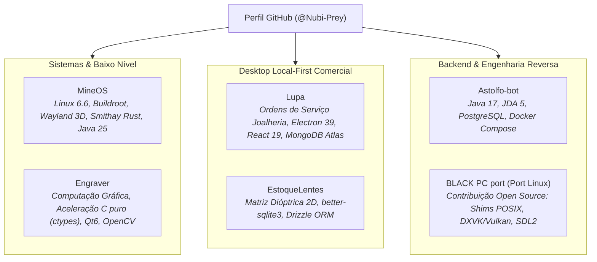

# Consolidação Integral da Sessão: Novo Portfólio Murilo Alves
**Data da Sessão:** 29 de Outubro de 2026  
**Autor:** Murilo Alves ([@Nubi-Prey](https://github.com/Nubi-Prey))  
**Novo Domínio Oficial:** [muriloalves.dev](https://muriloalves.dev)  
**Status do Projeto:** Fase de Planejamento Concluída — Pronto para Implementação

---

## 🧭 1. Resumo Executivo & Linha do Tempo

A sessão teve como objetivo inicial a análise e atualização do portfólio de projetos a partir dos **6 repositórios fixados no perfil GitHub (@Nubi-Prey)**. Durante o processo, constatou-se que o escopo e a complexidade técnica dos projetos do desenvolvedor haviam superado em muito a proposta inicial do site anterior (`Nubi.live`, criado em 2024 como "meu primeiro site").

A partir desse diagnóstico, a sessão evoluiu estrategicamente por cinco grandes marcos:
1. **Auditoria Técnica dos 6 Projetos Fixados:** Levantamento exaustivo de arquitetura, dependências, desafios de baixo nível e casos de uso de cada repositório.
2. **Criação do Documento `PORTFOLIO_PROJETOS.md` e Metadados:** Estruturação de documentação técnica detalhada no workspace e criação dos modelos `.github/portfolio.json` para cada repositório.
3. **Decisão de Marca & Domínio Próprio:** Aquisição do domínio **`muriloalves.dev`** no Cloudflare para conferir maior seriedade profissional e descontinuação definitiva do domínio legado `nubi.live`.
4. **Resolução do Dilema Arquitetural:** Opção explícita pela criação de um **novo repositório limpo (`muriloalves.dev`)** em vez de refatorar o `Nubi.live`, eliminando dívidas técnicas e preservando a história do primeiro projeto.
5. **Aprovação do Design System "Cyber-Industrial Terminal Documental":** Análise e validação dos mockups criados pelo usuário na pasta `UI/`, consolidando uma identidade visual de alta densidade técnica baseada em terminais, cantos retos e estética suíço-brutalista.

---

## 🔬 2. Ficha Técnica dos 6 Repositórios Fixados



### 1. MineOS: Minecraft como Compositor Wayland 3D Baremetal
- **Stack:** Linux Kernel 6.6 LTS, Buildroot 2025.02 LTS, Smithay (Rust), Java 25 (Adoptium Temurin), Fabric, VirGL 3D (DRM/KMS), QEMU/KVM, 9P VirtFS, Python (pytest, QMP, MCP).
- **Proposta:** JeOS Linux baremetal que executa o Minecraft como próprio servidor Wayland (`wayland-1`). Aplicações nativas Linux são renderizadas em blocos e superfícies 3D no jogo.
- **Engenharia:** Boot ultra-rápido (~3s), biblioteca nativa Smithay em Rust compilada para JVM, bypass de direct scanout no KMS virtual, software cursor para contornar inversão de eixos no VirGL e persistência zero-overhead com 9P VirtFS.

### 2. Engraver: Estúdio de Dithering para Gravação a Laser
- **Stack:** Python 3.10+, C puro (ctypes), PySide6 (Qt 6), OpenCV, Pillow, Nuitka, Inno Setup, GitHub Actions CI/CD.
- **Proposta:** Pré-processamento e difusão de erro para fotogravação a laser em metais nobres e joias.
- **Engenharia:** Aceleração nativa de difusão de erro em C puro (`dither_accel.c`), fórmula espectral calibrada para tons de pele em metais (`R×0.6 + G×0.3 + B×0.1`), visualizador duplo sincronizado (zoom 5% a 3200% com inspeção por pixel) e distribuição em binários autônomos sem dependência de Python.

### 3. Lupa: Gerenciador de Ordens de Serviço para Joalherias
- **Stack:** TypeScript 5.9, Electron 39, React 19, Tailwind CSS v4, Zustand 5, MongoDB Atlas (Mongoose 9), Fuse.js 7.
- **Proposta:** Sistema comercial desktop para controle de ordens de serviço em ateliês e oficinas de joalheria.
- **Engenharia:** Arquitetura híbrida local-first (cache instantâneo offline com sincronização resiliente na nuvem), busca fuzzy global via Command Bar (`Ctrl+K`), impressão formatada A4 em duas vias e notificação de clientes via deep link do WhatsApp.

### 4. EstoqueLentes: Gestão de Lentes Oftálmicas em Matriz 2D
- **Stack:** TypeScript, Electron 39, React 19, Tailwind CSS v4, Radix UI, better-sqlite3, Drizzle ORM, Vitest.
- **Proposta:** Gestão física de gaveteiros de blocos de lentes oftálmicas baseado em matriz de eixos esférico × cilíndrico.
- **Engenharia:** SQLite embutido com migrações automáticas no boot gerenciadas pelo Drizzle ORM (< 2ms de latência em disco), isolamento rigoroso de três processos do Electron com IPC 100% tipado e hook para leitor de código de barras USB.

### 5. Astolfo-bot: Bot Modular para Discord
- **Stack:** Java 17+, JDA 5, PostgreSQL 16, Docker Compose, Maven, Logback.
- **Proposta:** Bot corporativo modular de alta escalabilidade orientado a eventos.
- **Engenharia:** Desacoplamento entre listeners de ciclo de vida e despachante dinâmico de comandos (`CommandHandler`), ambiente conteinerizado reprodutível como código e isolamento estrito de segredos de runtime.

### 6. BLACK PC port (Port Linux): Contribuição Open Source
- **Stack:** C++, x86 Assembly, Linux (POSIX), SDL2, DXVK / Vulkan, Direct3D 9, CMake.
- **Proposta & Papel:** Contribuição de código aberto ao projeto `black-pc` (de Spark198rus) implementando o port nativo para Linux com shims POSIX para o kernel do Xbox (`xboxkrnl.exe`), gerenciamento de threads e memória virtual, DXVK sobre Vulkan e SDL2, sem depender de Wine ou Proton.

---

## 🏛️ 3. Registro de Decisões Arquiteturais (ADRs)

### ADR-01: Novo Repositório vs. Refatorar o Antigo
- **Decisão:** Criar um **novo repositório** (`Nubi-Prey/muriloalves.dev`).
- **Motivo:** O repositório legado `Nubi.live` utilizava Pages Router desatualizado, JavaScript puro, CSS Modules rígidos e dependências legadas. Criar um novo repositório zera a dívida técnica, permite utilizar Next.js 15 App Router + React 19 + TypeScript estrito + Tailwind v4, e preserva a história original do primeiro site no GitHub.

### ADR-02: Gestão de Domínios & Descontinuação do `nubi.live`
- **Decisão:** O domínio `nubi.live` será **descontinuado**; o domínio único e oficial passa a ser **`muriloalves.dev`**.
- **Motivo:** Elimina custos recorrentes de anuidade e manutenção de regras de redirecionamento ou proxies complexos. Todas as URLs canônicas, sitemaps e metadados OpenGraph serão configurados diretamente para `https://muriloalves.dev`.

### ADR-03: Topologia Cloudflare ⇄ Vercel
- **Decisão:** Domínio registrado no Cloudflare com CNAME Flattening no ápice apontando para `cname.vercel-dns.com`.
- **Regra de Criptografia Obrigatória:** **`Full (Strict)`** no Cloudflare para evitar loop de redirecionamento HTTP/HTTPS com os certificados automáticos da Vercel Edge.

### ADR-04: Design System "Cyber-Industrial Terminal Documental"
- **Decisão:** Adotar a identidade visual prototipada na pasta `UI/`.
- **Características:**
  - Cantos retos estruturais (`border-radius: 0px`);
  - Sombras mecânicas cinéticas duras (`box-shadow: 4px 4px 0px 0px #000000` / `#b83a20`);
  - Tipografia assimétrica: `Space Grotesk` (títulos arquiteturais) + `JetBrains Mono` (corpo, telemetria, código);
  - Cores: Burnt Terracotta (`#b83a20`), Tactical Sage (`#4e6851`), Parchment Sand (`#dcc9a9`), Pitch Stone (`#121314`).

---

## 🎨 4. Mapeamento dos Protótipos da Pasta `UI/`

Os modelos criados em `/home/nubi/Documents/portfolio/UI/` estabelecem a base exata dos componentes da aplicação:

1. **`DESIGN_dark.md`:** Especificação formal de tokens, cores, tipografia, elevação e comportamentos de componentes.
2. **`pagina_inicial_dark.html`:** Layout da homepage contendo:
   - Header fixo com marcação de terminal (`[muriloalves.dev]`);
   - Hero com apresentação de Engenharia de Sistemas e card de perfil;
   - Grid de 6 projetos em 3 colunas com tags de tecnologias e flags de status (`BAREMETAL`, `OFFLINE RESILIENT`, `IMAGE PROCESSING`);
   - Matriz de competências dividida em 4 quadrantes;
   - Rodapé com PGP Key Fingerprint, licenças e canais de contato.
3. **`pagina_detalhes_light.html`:** Layout da página individual de estudo de caso (exemplo: `EstoqueLentes`):
   - Grid com 6 caixas de especificações técnicas (`[SPEC_01]` a `[SPEC_06]`);
   - Quadro analítico comparando o Desafio Físico/Óptico vs a Solução Local-First;
   - Diagrama arquitetural em 3 camadas de isolamento do Electron IPC.
4. **`pagina_inicial_light.html`:** Versão de alto contraste em tons de pedra e papel técnico para impressão/leitura diurna.

---

## 🚀 5. Roteiro de Implementação (Próxima Sessão)

Quando a fase de código for iniciada, a execução seguirá este passo a passo:

1. **Inicialização do Projeto Next.js 15:**
   ```bash
   npx create-next-app@latest . --typescript --tailwind --eslint --app --src-dir --import-alias "@/*" --use-npm
   ```
2. **Configuração de Fontes & Design Tokens:**
   - Importar `Space Grotesk` e `JetBrains Mono` via `next/font/google`.
   - Mapear as variáveis de cor (Terracotta, Tactical Sage, Sand, Pitch Stone) no `src/app/globals.css`.
3. **Componentização Modular:**
   - `src/components/Header.tsx` (Navbar com status de disponibilidade).
   - `src/components/Hero.tsx` (Apresentação e card de perfil).
   - `src/components/ProjectCard.tsx` (Card brutalista com tags e links).
   - `src/components/Competencies.tsx` (Matriz de áreas de atuação).
   - `src/components/Footer.tsx` (PGP, redes e metadados).
4. **Data Layer Dinâmico (`src/lib/github.ts`):**
   - Query GraphQL para buscar os repositórios fixados em build-time com ISR.
   - Fallback local estático para renderização offline garantida.
5. **Páginas Dinâmicas de Estudo de Caso:**
   - Criar `src/app/projects/[slug]/page.tsx` para renderizar os detalhes técnicos de cada software com base no modelo `pagina_detalhes_light.html`.
6. **Deploy & Publicação:**
   - Criar repositório público `Nubi-Prey/muriloalves.dev` via GitHub CLI (`gh`).
   - Importar projeto na Vercel e configurar o domínio Cloudflare `muriloalves.dev` com SSL Full (Strict).

---

*Arquivo gerado para consolidação da sessão e transição contínua para a implementação.*
