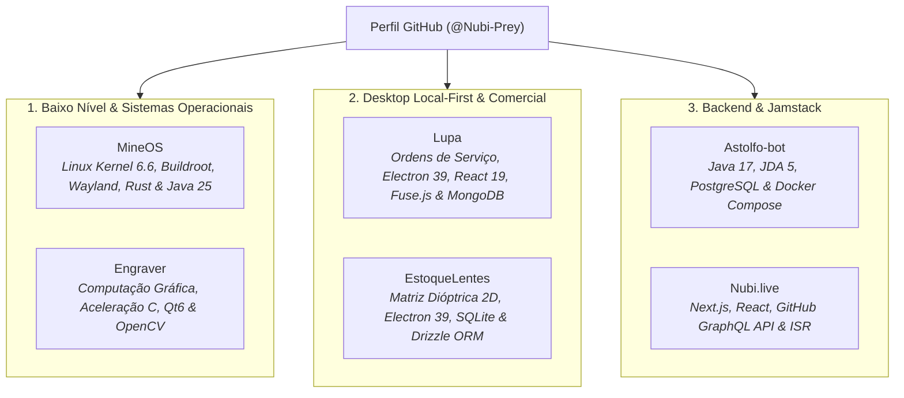
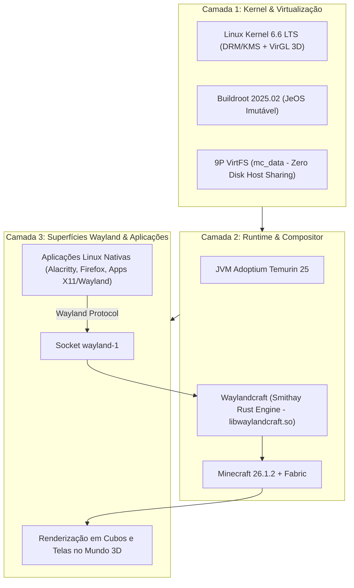
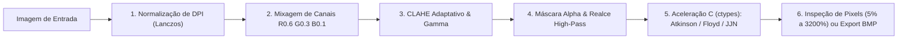
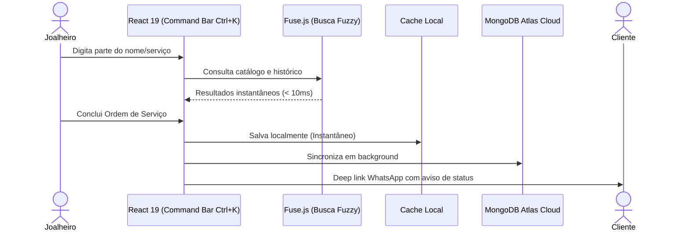
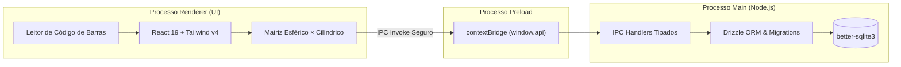
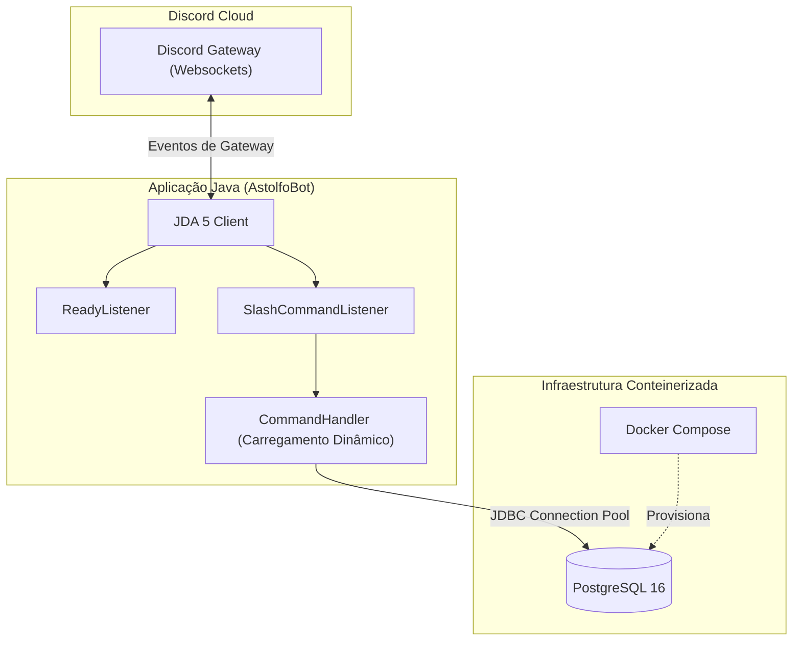
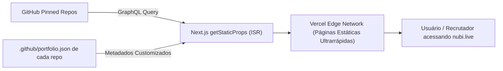

# Portfólio de Engenharia de Software & Projetos
**Autor:** Nubi ([@Nubi-Prey](https://github.com/Nubi-Prey))  
**Website:** [nubi.live](https://nubi.live)  
**Foco:** Engenharia de Sistemas & Kernel, Aplicações Desktop Local-First, Computação Gráfica e Arquitetura de Software

---

## 🧭 Visão Geral

Este documento apresenta uma análise técnica aprofundada dos **6 projetos fixados** no perfil GitHub de **@Nubi-Prey**. O conjunto de projetos reflete versatilidade técnica rara: desde o desenvolvimento em baixo nível com compilação de distribuições Linux customizadas (Kernel, Buildroot, Wayland, Rust) até aplicações desktop comerciais completas com arquiteturas local-first (Electron, SQLite, MongoDB Atlas) e processamento matemático de imagens acelerado em C puro.

---

## 📊 Matriz de Competências & Tecnologias

| Projeto | Domínio / Área | Linguagens Principais | Frameworks / Ferramentas | Persistência / Banco | Arquitetura & Diferencial |
| :--- | :--- | :--- | :--- | :--- | :--- |
| **[MineOS](#1-mineos-minecraft-como-compositor-gráfico-wayland-3d)** | Sistemas & Kernel | Java 25, Rust, C, Python | Buildroot 2025.02, Smithay, Fabric, Wayland, QEMU | 9P VirtFS (Zero Copy) | Compositor Wayland rodando em blocos 3D baremetal |
| **[Engraver](#2-engraver-estúdio-de-dithering-para-gravação-a-laser)** | Computação Gráfica | Python 3.10+, C puro | PySide6 (Qt 6), OpenCV, Pillow, Nuitka | JSON Presets | Aceleração C (ctypes) de difusão de erro e pipeline tonal |
| **[Lupa](#3-lupa-gerenciador-de-ordens-de-serviço-para-joalheria)** | Desktop Comercial | TypeScript 5.9 | Electron 39, React 19, Tailwind v4, Zustand 5, Fuse.js | MongoDB Atlas (Mongoose 9) | Local-First, Command Bar (Ctrl+K) e WhatsApp API |
| **[EstoqueLentes](#4-estoquelentes-gestão-física-de-estoque-de-lentes)** | Desktop Especializado | TypeScript | Electron 39, React 19, Tailwind v4, Radix UI | SQLite (better-sqlite3) + Drizzle | Matriz bidimensional dióptrica com auto-save e migrações |
| **[Astolfo-bot](#5-astolfo-bot-bot-modular-para-discord)** | Backend & DevOps | Java 17+ | JDA 5, Maven, Logback | PostgreSQL (Docker Compose) | Slash Commands dinâmicos e isolamento de secrets |
| **[Nubi.live](#6-nubilive-portfólio-jamstack-dinâmico)** | Frontend Jamstack | JavaScript, TypeScript | Next.js, React, Tailwind CSS | GitHub GraphQL API | ISR com desacoplamento via `.github/portfolio.json` |

---

## 🔬 Análise Detalhada dos Projetos

---

### 1. MineOS: Minecraft como Compositor Gráfico Wayland 3D
> *"Simplicidade brutal no backend e a loucura total no frontend."*

#### 📌 Descrição & Proposta
O **MineOS** é uma distribuição Linux completa construída sob medida no formato **JeOS** (*Just Enough OS*) usando o framework industrial **Buildroot (LTS 2025.02)**. Seu propósito é transformar o jogo **Minecraft** no próprio **Compositor Gráfico Wayland baremetal** da máquina (`wayland-1`). Aplicações nativas Linux são executadas na sessão e renderizadas em texturas de blocos tridimensionais no mundo do jogo, com suporte a mouse, teclado e aceleração por hardware.

#### 🛠️ Destaques de Engenharia & Resolução de Problemas Complexos
- **Arquitetura de Compilação Modular (`BR2_EXTERNAL`):** Imagem com boot express (~3 segundos) com inicialização minimalista, sem daemons desnecessários, carregando estritamente os subsistemas de DRM, KMS, `seatd` e `libinput`.
- **Ponte de Baixo Nível Rust + Java 25:** O mod Waylandcraft foi arquitetado com um motor em Rust usando a biblioteca **Smithay** (`libwaylandcraft.so`), comunicando-se com Mixins do Fabric na JVM Java 25 para despachar buffers gráficos diretamente na thread de renderização do Minecraft.
- **Bypass de Gargalos Gráficos e DRM:**
  - *Direct Scanout Bypass:* Correção de engasgos e congelamento de render thread via variáveis de cena (`WLR_SCENE_DISABLE_DIRECT_SCANOUT=1` e `WLR_DRM_NO_ATOMIC=1`).
  - *Inversão de Eixos VirGL:* Superação de bug de driver 3D que invertia o cursor a 180° forçando renderização de cursor em software (`WLR_NO_HARDWARE_CURSORS=1`).
  - *Trava de Mouse 360°:* Patch customizado para o compositor Cage expondo `relative-pointer-v1` e `pointer-constraints-v1` sob SDL2.
- **Zero Overhead de Disco com 9P VirtFS:** O sistema raiz permanece somente-leitura enquanto diretórios de dados de mundos e mods são mapeados em tempo real diretamente da máquina host via VirtFS.
- **Observabilidade Automatizada:** Suíte de testes em Python (`pytest`) que controla o QEMU via socket **QMP** (*QEMU Machine Protocol*) com suporte a telemetria via servidor MCP (*Model Context Protocol*).

---

### 2. Engraver: Estúdio de Dithering para Gravação a Laser
> *Estúdio profissional de pré-processamento e difusão de erro para fotogravação industrial.*

#### 📌 Descrição & Proposta
Aplicação de desktop e linha de comando (CLI) voltada para a preparação milimétrica de imagens a serem gravadas a laser em metais nobres, joias e brindes finos. Desenvolvida para resolver as limitações de contraste e perda de detalhes que ocorrem em gravadoras industriais (fibras ópticas, MOPA, UV e CO₂).

#### 🛠️ Destaques de Engenharia & Resolução de Problemas Complexos
- **Aceleração Nativa em C Puro (`dither_accel.c`):** O cálculo de difusão de erro para resoluções elevadas (600+ DPI) em Python puro causava gargalos severos. O algoritmo de difusão foi implementado em C puro e consumido via `ctypes`, conferindo velocidade instantânea para algoritmos pesados como **Atkinson** e **Jarvis-Judice-Ninke**.
- **Fórmula Espectral Calibrada para Metais:** Mixagem de canais monocromáticos customizada (`Gray = R×0.6 + G×0.3 + B×0.1`) especificamente calibrada para realçar tons de pele e contraste facial quando expostos à reflexão de ligas de ouro, prata e aço inox.
- **Visualizador Duplo Sincronizado com Pixel Inspection:** PySide6/Qt6 com zoom sincronizado de 5% a 3200% em modo *Nearest Neighbor*, permitindo ao operador de máquina inspecionar exatamente cada microponto de queima do feixe laser antes de iniciar a produção.
- **Pipeline de Distribuição Autônoma:** Empacotamento compilado com **Nuitka** e automação com GitHub Actions, gerando instaladores nativos para Windows (Inno Setup), Linux (.AppImage) e macOS sem exigir Python pré-instalado na máquina do usuário final.

---

### 3. Lupa: Gerenciador de Ordens de Serviço para Joalheria
> *Sistema comercial desktop com arquitetura local-first e sincronização em nuvem.*

#### 📌 Descrição & Proposta
Gerenciador desktop especializado no fluxo de trabalho de ateliês e oficinas de joalheria. Substitui blocos de papel e planilhas por um sistema centralizado com busca instantânea, impressão de ordens em duas vias e integração com clientes.

#### 🛠️ Destaques de Engenharia & Resolução de Problemas Complexos
- **Arquitetura Local-First Híbrida:** A oficina não para se a conexão de internet cair; todas as operações ocorrem primeiro contra o cache local com reatividade imediata e são sincronizadas de forma resiliente com o cluster **MongoDB Atlas**.
- **Busca Fuzzy com Fuse.js integrada à Command Bar (`Ctrl+K`):** Navegação e localização ultrarrápida de clientes, peças, orçamentos e serviços sem necessidade de múltiplos cliques.
- **Impressão Formatada em Duas Vias (A4):** Geração de layouts de impressão em tons de cinza otimizados para papel comum ou timbrado, contendo via da oficina e canhoto do cliente com termos de garantia e retirada.
- **Deep Linking com WhatsApp:** Geração automática de mensagens personalizadas e abertura do WhatsApp Web/Desktop com 1 clique para notificar clientes sobre orçamentos aprovados ou serviços prontos para retirada.

---

### 4. EstoqueLentes: Gestão Física de Estoque de Lentes
> *Aplicação desktop offline com banco de dados embutido e matriz dióptrica bidimensional.*

#### 📌 Descrição & Proposta
Software desktop focado na gestão física de gavetas e caixas de blocos de lentes oftálmicas em laboratórios e óticas. Sua interface é construída em torno da clássica matriz de dois eixos dióptricos: **Grau Esférico** (linhas) versus **Grau Cilíndrico** (colunas).

#### 🛠️ Destaques de Engenharia & Resolução de Problemas Complexos
- **Persistência Local-First com Drizzle ORM + better-sqlite3:** Armazenamento embutido em arquivo SQLite nativo criado em `app.getPath('userData')`, executando migrations versionadas automaticamente no boot do app, eliminando custos de infraestrutura e latência de rede.
- **Segurança e Rigor Arquitetural no Electron:** Separação estrita em três processos (`main`, `preload` e `renderer`). O processo de interface React não tem acesso direto ao sistema de arquivos nem ao Node.js; toda a comunicação é mediada por canais IPC com tipagem estrita de contratos em TypeScript.
- **UX de Alta Produtividade:** Matriz reativa com atualização atômica de quantidades, suporte a leitor óptico de código de barras para entradas e saídas rápidas e salvamento automático contínuo.

---

### 5. Astolfo-bot: Bot Modular para Discord
> *Microsserviço orientado a eventos em Java com PostgreSQL conteinerizado.*

#### 📌 Descrição & Proposta
Bot para Discord com arquitetura modular, focado em alta disponibilidade e código limpo utilizando a versão mais recente do framework JDA 5. Integra-se com banco de dados relacional PostgreSQL gerenciado como código via Docker Compose.

#### 🛠️ Destaques de Engenharia & Resolução de Problemas Complexos
- **Carregamento Dinâmico de Comandos:** Arquitetura orientada a eventos com separação clara de responsabilidades: `CommandHandler` descobre, valida e registra Slash Commands na API do Discord em runtime, desacoplando a lógica de cada comando da inicialização do bot.
- **Infraestrutura como Código (IaC):** O ambiente de banco de dados é 100% reproduzível via `infra/compose.yaml` com diretório de inicialização de schemas (`docker-entrypoint-initdb.d`), facilitando testes locais e deploys em servidores Linux remotos.
- **Práticas de Segurança de Credenciais:** Separação estrita de runtime: credenciais críticas (Token do bot e string de conexão JDBC) são injetadas estritamente via variáveis de ambiente do sistema, enquanto parâmetros públicos residem em `config.properties`.

---

### 6. Nubi.live: Portfólio Jamstack Dinâmico
> *Website pessoal construído com geração estática incremental conectada à API GraphQL do GitHub.*

#### 📌 Descrição & Proposta
O site oficial de apresentação técnica do desenvolvedor. Projetado com filosofia Jamstack: a lista de projetos do portfólio não é estática nem mantida em CMSs pesados; ela é sincronizada automaticamente com os repositórios fixados do perfil GitHub através da API GraphQL.

#### 🛠️ Destaques de Engenharia & Resolução de Problemas Complexos
- **Padrão Descentralizado de Metadados:** Cada projeto dita como quer ser exibido criando um arquivo `.github/portfolio.json` em seu próprio repositório. Projetos em desenvolvimento sem esse arquivo são automaticamente omitidos do catálogo público.
- **Performance com ISR (Incremental Static Regeneration):** O site é servido com velocidade de página estática direta da CDN Edge da Vercel, revalidando dados em background sem requisições desnecessárias a cada visualização de página.

---

## 🎯 Síntese de Valor para Recrutadores & Líderes Técnicos

| Perfil / Necessidade | Como os projetos comprovam a competência |
| :--- | :--- |
| **Sistemas, Kernel & Baixo Nível** | O **MineOS** demonstra que o autor não teme a barreira do baremetal: configurou kernels Linux, escreveu módulos nativos em Rust/Smithay, domina compiladores com Buildroot e resolveu problemas de baixo nível em drivers DRM e Wayland. |
| **Computação Gráfica & Desempenho** | O **Engraver** comprova capacidade algorítmica matemática (dithering e processamento tonal), otimização com C nativo (`ctypes`) e entrega de ferramentas industriais com executáveis autônomos. |
| **Engenharia de Software Desktop & Local-First** | O **Lupa** e o **EstoqueLentes** mostram domínio profundo de Electron, React 19, TypeScript e arquiteturas resilientes offline (SQLite/Drizzle e MongoDB Atlas), resolvendo gargalos reais de gestão de negócios. |
| **Backend, Microsserviços & Nuvem** | O **Astolfo-bot** e o **Nubi.live** comprovam a base sólida em POO (Java 17), DevOps (Docker Compose, CI/CD Actions, Vercel) e consumo eficiente de APIs de grafos (GraphQL). |

---

*Documento gerado e revisado para o portfólio de @Nubi-Prey.*
